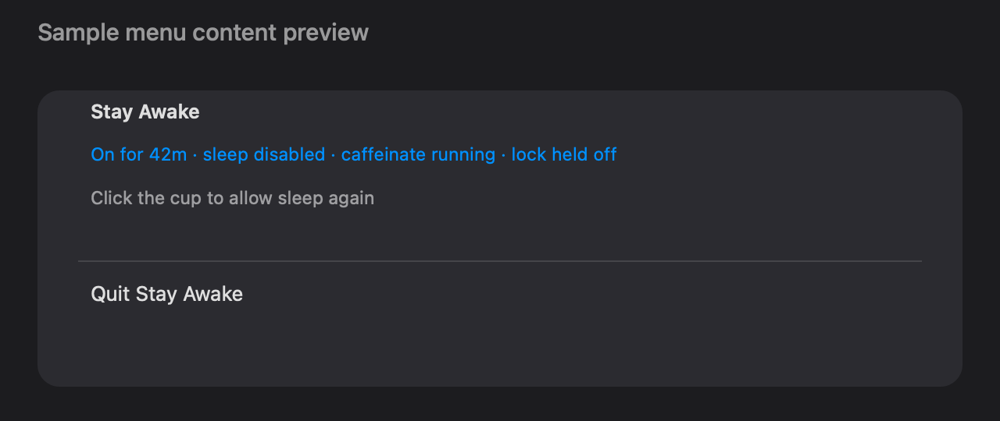

# Stay Awake

<p align="center"></p>

Stay Awake is a small macOS menu-bar app that keeps a Mac awake during long-running local work. Click the cup to turn it on; click it again to restore normal sleep and lock behaviour.

It supports macOS 13 and later and has no network access, analytics, or bundled dependencies.

## Install

You need the Xcode Command Line Tools (`xcode-select --install`). Then:

```sh
git clone https://github.com/ayush5harma/stay-awake.git
cd stay-awake
bash install.sh
```

The installer builds `/Applications/Stay Awake.app` and registers a per-user LaunchAgent so the menu-bar item starts at login. It does not change power settings during installation.

Turning the app on needs administrator authorization for `pmset`. Without any further setup, macOS asks for your password each time. The optional, narrowly scoped [`sudoers/stay-awake.example`](sudoers/stay-awake.example) rule allows only these two commands without a password:

```text
/usr/bin/pmset -a disablesleep 1
/usr/bin/pmset -a disablesleep 0
```

Replace `<username>` in a scratch copy, validate it with `visudo`, then install it as described in that file. Review the rule before installing it.

To remove the app and its LaunchAgent:

```sh
bash install.sh --uninstall
```

Uninstall clears `pmset`'s `SleepDisabled` value if it is set, removes the app and LaunchAgent, and leaves any sudoers file for you to remove separately.

## What turning it on does

Stay Awake combines three local mechanisms:

1. `pmset -a disablesleep 1` prevents clamshell sleep. This is a persistent system-wide setting and requires administrator authorization.
2. `caffeinate -dimsu -w <app-pid>` prevents idle, display, disk, and system sleep while the app runs.
3. An IOKit user-activity assertion is refreshed every minute to keep the idle lock timer from firing.

The app reads `pmset` regularly and uses that value as its displayed state. Turning it off, quitting through its menu, uninstalling it, or running `sudo pmset -a disablesleep 0` restores normal sleep behaviour. Treat the app as a local power-management tool: it deliberately keeps the session unlocked while it is on.

## Build from source

Build into a scratch directory without installing or launching the app:

```sh
scratch=$(mktemp -d)
APP_DIR="$scratch" bash build.sh --force
```

`build.sh` uses `swiftc` directly and ad-hoc signs the result. Its `APP_DIR` option is useful for testing; only the default `/Applications` destination can interact with an already installed LaunchAgent.

## Menu-content preview fixture

The image above is a compact AppKit preview of the production menu's own attributed `NSMenuItem` content, not a screen capture or a native-menu screenshot. It uses fixed sample status data and exits before creating the application, reading or changing `pmset`, starting `caffeinate`, creating timers, or touching a LaunchAgent.

```sh
scratch=$(mktemp -d)
APP_DIR="$scratch" bash build.sh --force
"$scratch/Stay Awake.app/Contents/MacOS/StayAwake" --screenshot-fixture docs/images/menu.png
```

## Contributing

Read [CONTRIBUTING.md](CONTRIBUTING.md) for local checks, scope, and security reporting. Bug reports and feature proposals use the issue templates; pull requests use the checklist in the pull request template.

The previous detailed build and implementation notes are preserved in [docs/REFERENCE.md](docs/REFERENCE.md).

## Licence

[MIT](LICENSE).
