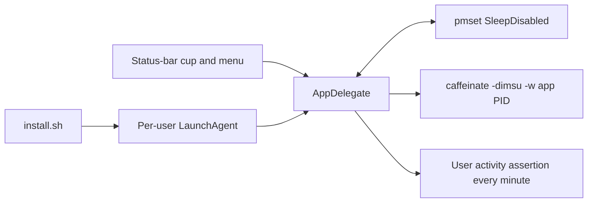

# Architecture

Stay Awake is an AppKit menu-bar app with one authoritative state: the
system's `pmset SleepDisabled` value. Its menu state follows that value instead
of an in-memory toggle, so a restart or terminal change is reflected on the
next poll.

## Power and authorization boundaries

`pmset -a disablesleep` is a persistent system-wide setting and requires
administrator authorization. The app first tries the optional narrowly scoped
sudo rule, then uses the standard macOS administrator dialog. The rule allows
only the on and off `pmset` invocations documented in `sudoers/`.

`caffeinate` is tied to the app process, so it exits with that process. The
IOKit assertion keeps idle locking from occurring while the app is deliberately
on. A normal menu quit turns sleep back on; a KeepAlive relaunch preserves the
system setting and reattaches the process-bound mechanisms.

## File map

| Path | Responsibility |
| --- | --- |
| `Sources/main.swift` | status item, menu, power state, and safe preview fixture |
| `Sources/icon.swift` | generated app icon artwork |
| `build.sh` | direct Swift build and ad-hoc signing |
| `install.sh` | app installation and per-user LaunchAgent lifecycle |
| `launchd/` | LaunchAgent template |
| `sudoers/` | optional two-command authorization rule |

The preview fixture exits before `NSApplication` starts and does not read or
change power settings. Operational detail remains in [REFERENCE.md](REFERENCE.md).
